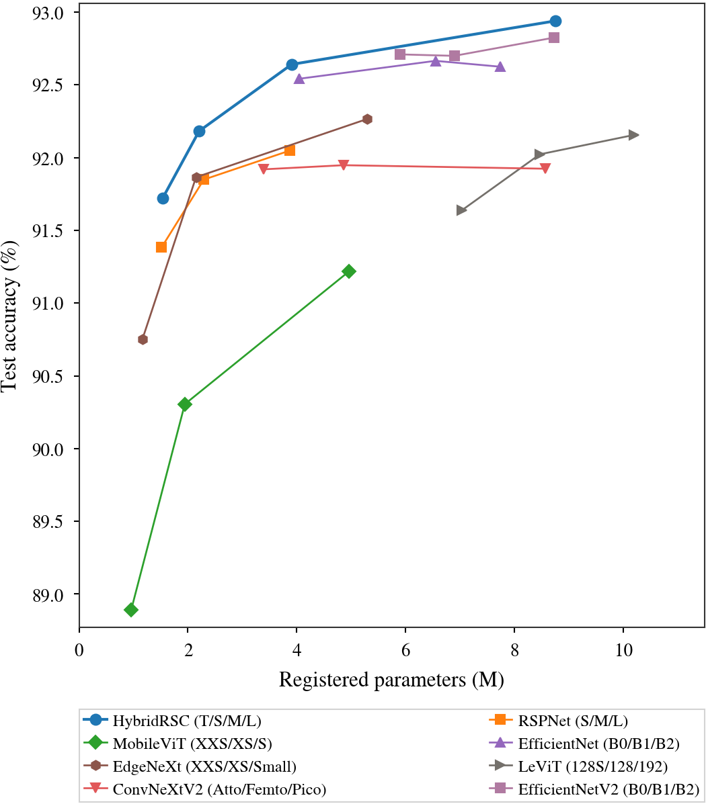
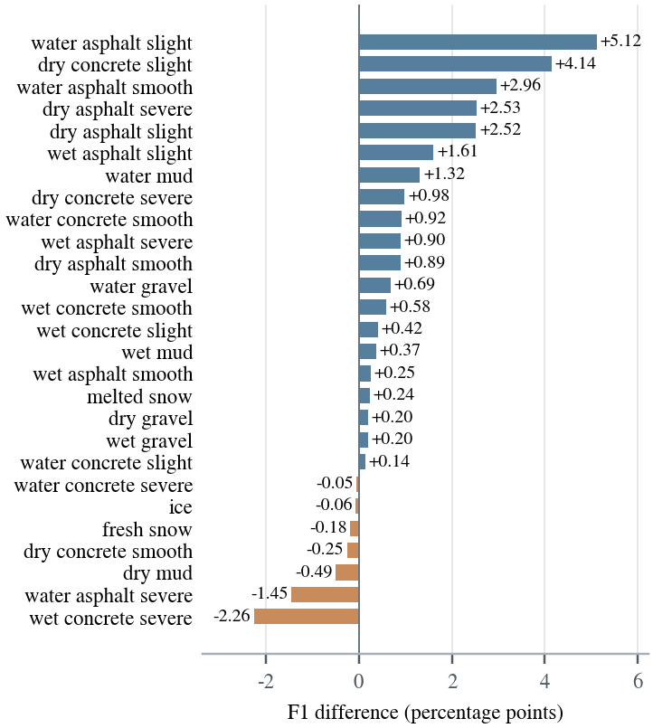

<div align="center">

<h1>HybridRSC</h1>
<h3>Compact Gated CNN–Attention Networks for Fine-Grained Road Surface Classification</h3>

<p>
  <a href="#weights"></a>
  <a href="LICENSE"></a>
</p>

<p>
  <a href="#abstract">Abstract</a> ·
  <a href="#performance">Performance</a> ·
  <a href="#results">Results</a> ·
  <a href="#installation">Installation</a> ·
  <a href="#usage">Usage</a>
</p>

</div>

> **Release status:** This repository currently contains the project overview and results. Source code, configurations, and reproduction files will be released in a subsequent update. The installation and usage sections below preview the prepared release.

## Abstract

Camera-based road surface classification requires accurate fine-grained recognition of surface condition, material, and unevenness under tight onboard compute budgets. We present HybridRSC, a compact four-stage family (T, S, M, and L; 1.54–8.75 M parameters) for 27-class road-patch classification. HybridRSC pairs high-resolution convolutional stages with two-dimensional gated depthwise-convolutional mixing and low-resolution full-map self-attention to capture local texture and broader spatial context at compact model scales. Evaluated across 25 compact models from eight families on the 49,500-patch official RSCD test split under a unified three-view protocol, HybridRSC-M (3.906 M) achieves 92.64% accuracy and 90.42% Macro-F1, improving over released RSPNet-L by 0.59 and 0.69 percentage points while lowering shared-session GPU batch-1 latency by 66.1% and unified end-to-end median latency by 51.1% on an RTX 5090. HybridRSC-L (8.754 M) reaches 92.94% accuracy and 90.82% Macro-F1, demonstrating favorable accuracy–efficiency trade-offs across compact budgets.

## Performance

<p align="center">
  
</p>

<p align="center"><em>Test accuracy versus model size on RSCD. Colors and markers identify model families.</em></p>

## Results

Results use the **49,500-patch official test split** and the same **three-view probability averaging** protocol. HybridRSC and general-purpose baselines use seed-3407 checkpoints selected by validation Macro-F1; RSPNet uses author-released checkpoints.

### HybridRSC family

| Model | Params (M) | Accuracy (%) | Macro-F1 (%) | GPU B1 (ms) | GPU B32 (img/s) | E2E B1 (ms) |
|:--|--:|--:|--:|--:|--:|--:|
| **HybridRSC-T** | 1.537 | 91.72 | 89.21 | 2.308 | 5756 | 5.26 |
| **HybridRSC-S** | 2.206 | 92.18 | 89.80 | 2.337 | 5222 | 5.23 |
| **HybridRSC-M** | 3.906 | 92.64 | 90.42 | 2.429 | 4324 | 5.33 |
| **HybridRSC-L** | 8.754 | 92.94 | 90.82 | 2.632 | 2812 | 5.57 |

GPU timings use RTX 5090 devices, FP32 eager execution, and disabled TF32. B1 latency and B32 throughput count source patches, with three crops per patch. HybridRSC and RSPNet share one GPU timing session; general-purpose backbones are measured in paired sessions with fixed HybridRSC-M references. E2E B1 reports the mean of the three session medians from a unified 25-model benchmark on one RTX 5090. It measures warm-cache JPEG decoding, preprocessing, device transfer, inference, view fusion, and CPU label return; camera acquisition and downstream vehicle processing are excluded.

<details>
<summary><strong>Full comparison: 25 models across T/S/M/L parameter budgets</strong></summary>

Bold values mark the best displayed result within each parameter-budget group, including ties.

### Tiny: up to 1.8M parameters

| Model | Params ↓ (M) | Acc. ↑ (%) | Macro-R ↑ (%) | Macro-F1 ↑ (%) | GPU B1 ↓ (ms) | GPU B32 ↑ (img/s) | E2E B1 ↓ (ms) |
|:--|--:|--:|--:|--:|--:|--:|--:|
| [MobileViT-XXS](https://arxiv.org/abs/2110.02178) | **0.960** | 88.89 | 86.17 | 85.61 | 2.831 | 2901 | 5.86 |
| [EdgeNeXt-XXS](https://arxiv.org/abs/2206.10589) | 1.163 | 90.75 | 88.49 | 88.07 | 2.509 | 3169 | 5.35 |
| [RSPNet-S](https://doi.org/10.1016/j.eswa.2026.132831) | 1.515 | 91.38 | 88.09 | 88.77 | 5.911 | 2717 | 9.44 |
| **HybridRSC-T** | 1.537 | **91.72** | **89.71** | **89.21** | **2.308** | **5756** | **5.26** |

### Small: above 1.8M to 3M parameters

| Model | Params ↓ (M) | Acc. ↑ (%) | Macro-R ↑ (%) | Macro-F1 ↑ (%) | GPU B1 ↓ (ms) | GPU B32 ↑ (img/s) | E2E B1 ↓ (ms) |
|:--|--:|--:|--:|--:|--:|--:|--:|
| [MobileViT-XS](https://arxiv.org/abs/2110.02178) | **1.943** | 90.31 | 87.95 | 87.42 | 6.138 | 1352 | 6.27 |
| [EdgeNeXt-XS](https://arxiv.org/abs/2206.10589) | 2.149 | 91.86 | 89.75 | 89.50 | 3.003 | 3332 | 5.89 |
| [RSPNet-M](https://doi.org/10.1016/j.eswa.2026.132831) | 2.292 | 91.85 | 88.73 | 89.37 | 6.055 | 2548 | 9.70 |
| **HybridRSC-S** | 2.206 | **92.18** | **90.18** | **89.80** | **2.337** | **5222** | **5.23** |

### Medium: above 3M to 5.5M parameters

| Model | Params ↓ (M) | Acc. ↑ (%) | Macro-R ↑ (%) | Macro-F1 ↑ (%) | GPU B1 ↓ (ms) | GPU B32 ↑ (img/s) | E2E B1 ↓ (ms) |
|:--|--:|--:|--:|--:|--:|--:|--:|
| [ConvNeXtV2-Atto](https://arxiv.org/abs/2301.00808) | **3.396** | 91.92 | 89.68 | 89.52 | **2.063** | 2445 | **4.99** |
| [RSPNet-L](https://doi.org/10.1016/j.eswa.2026.132831) | 3.877 | 92.05 | 89.18 | 89.72 | 7.164 | 1959 | 10.90 |
| [EfficientNet-B0](https://arxiv.org/abs/1905.11946) | 4.042 | 92.54 | 90.36 | 90.26 | 3.071 | 2126 | 5.92 |
| [ConvNeXtV2-Femto](https://arxiv.org/abs/2301.00808) | 4.859 | 91.95 | 89.68 | 89.62 | 2.129 | 1959 | 5.03 |
| [MobileViT-S](https://arxiv.org/abs/2110.02178) | 4.955 | 91.22 | 88.86 | 88.50 | 3.013 | 1001 | 5.95 |
| [EdgeNeXt-Small](https://arxiv.org/abs/2206.10589) | 5.290 | 92.26 | 90.11 | 89.94 | 5.191 | 2132 | 5.94 |
| **HybridRSC-M** | 3.906 | **92.64** | **90.73** | **90.42** | 2.429 | **4324** | 5.33 |

### Large: above 5.5M to 11M parameters

| Model | Params ↓ (M) | Acc. ↑ (%) | Macro-R ↑ (%) | Macro-F1 ↑ (%) | GPU B1 ↓ (ms) | GPU B32 ↑ (img/s) | E2E B1 ↓ (ms) |
|:--|--:|--:|--:|--:|--:|--:|--:|
| [EfficientNetV2-B0](https://arxiv.org/abs/2104.00298) | **5.893** | 92.71 | 90.57 | 90.47 | 4.043 | 2262 | 7.19 |
| [EfficientNet-B1](https://arxiv.org/abs/1905.11946) | 6.548 | 92.66 | 90.50 | 90.45 | 7.879 | 1433 | 8.44 |
| [EfficientNetV2-B1](https://arxiv.org/abs/2104.00298) | 6.895 | 92.70 | 90.66 | 90.53 | 4.879 | 1772 | 8.30 |
| [LeViT-128S](https://arxiv.org/abs/2104.01136) | 7.028 | 91.64 | 89.44 | 89.15 | 3.357 | **4899** | 6.33 |
| [EfficientNet-B2](https://arxiv.org/abs/1905.11946) | 7.739 | 92.62 | 90.56 | 90.49 | 8.832 | 1295 | 9.80 |
| [LeViT-128](https://arxiv.org/abs/2104.01136) | 8.465 | 92.02 | 89.95 | 89.72 | 4.093 | 4021 | 7.37 |
| [ConvNeXtV2-Pico](https://arxiv.org/abs/2301.00808) | 8.567 | 91.92 | 89.60 | 89.59 | **2.477** | 1453 | **5.40** |
| [EfficientNetV2-B2](https://arxiv.org/abs/2104.00298) | 8.725 | 92.82 | 90.77 | 90.70 | 8.980 | 1295 | 12.52 |
| [LeViT-192](https://arxiv.org/abs/2104.01136) | 10.198 | 92.16 | 90.05 | 89.81 | 4.123 | 3280 | 7.31 |
| **HybridRSC-L** | 8.754 | **92.94** | **91.07** | **90.82** | 2.632 | 2812 | 5.57 |

</details>

### Class-wise recognition

<p align="center">
  
</p>

Per-class validation F1 differences between HybridRSC-M and released RSPNet-L on the same 19,860 road patches. Positive values indicate higher F1 for HybridRSC-M; negative values indicate higher F1 for RSPNet-L. Values are percentage-point differences.

## Installation

### Tested environment

| Component | Version |
|:--|:--|
| Python | 3.10.19 |
| PyTorch | 2.12.1 + CUDA 13.0 build |
| Torchvision | 0.27.1 + CUDA 13.0 build |
| Pillow | 12.1.1 |
| PyYAML | 6.0.3 |

After the source release, run from the repository root:

```bash
conda create -n hybridrsc python=3.10 -y
conda activate hybridrsc
python -m pip install -r requirements.txt
```

For GPU use, select a PyTorch build compatible with your system and driver using the [official installation guide](https://pytorch.org/get-started/locally/). The versions above record the tested development environment. HybridRSC-T/S/M/L use standard PyTorch operations without custom CUDA extensions.

Check the installation:

```bash
python -c "import torch, torchvision; print('PyTorch:', torch.__version__); print('Torchvision:', torchvision.__version__); print('CUDA available:', torch.cuda.is_available())"
```

## Weights

Checkpoints are hosted at [jinbo2277/HybridRSC on Hugging Face](https://huggingface.co/jinbo2277/HybridRSC). The repository is currently private and requires authorized access. Download a checkpoint and pass its local path with `--checkpoint` for evaluation or inference.

## Usage

### 1. Prepare RSCD

Obtain RSCD from its [official website](https://thu-rsxd.com/rscd/) and preserve the official training, validation, and test splits. Dataset images and split CSVs are not included in this repository.

Each CSV needs `relative_path` and `class_id` columns; additional columns are allowed:

```csv
relative_path,class_id
train/example.jpg,0
```

Image paths are relative to `--data-root`. Class IDs must follow `datasets/labels.py`, which defines the 27-class order used by the checkpoints. The training split must contain all 27 classes for Balanced Softmax.

### 2. Select a configuration

| Model | Configuration | Default output |
|:--|:--|:--|
| HybridRSC-T | `configs/hybridrsc_t.yaml` | `runs/hybridrsc_t` |
| HybridRSC-S | `configs/hybridrsc_s.yaml` | `runs/hybridrsc_s` |
| HybridRSC-M | `configs/hybridrsc_m.yaml` | `runs/hybridrsc_m` |
| HybridRSC-L | `configs/hybridrsc_l.yaml` | `runs/hybridrsc_l` |

Model configurations override `configs/default.yaml`. Command-line values take precedence. Data paths can be set in the shared configuration or supplied as command-line arguments.

### 3. Train

```bash
python train.py --config configs/hybridrsc_m.yaml \
  --data-root /path/to/RSCD \
  --train-csv /path/to/train.csv \
  --val-csv /path/to/val.csv \
  --output runs/hybridrsc_m_seed3407
```

The default recipe uses one device, batch size 256 without gradient accumulation, 60 epochs, AdamW, Balanced Softmax, and seed 3407. The backbone and classifier learning rates are 0.0005 and 0.001, with weight decay 0.05, five warm-up epochs, cosine decay to 0.000001, and gradient clipping at 5.0. CUDA training uses BF16 mixed precision.

For additional seeds, use separate output directories:

```bash
python train.py --config configs/hybridrsc_m.yaml --seed 3408 --output runs/hybridrsc_m_seed3408
python train.py --config configs/hybridrsc_m.yaml --seed 3409 --output runs/hybridrsc_m_seed3409
```

These short commands use data paths from `configs/default.yaml`; the same data-path overrides shown above can also be supplied. Each run saves `config.yaml`, `train.jsonl`, and `best.pt`. The best checkpoint maximizes three-view validation Macro-F1, with lower validation NLL breaking ties.

### 4. Evaluate

```bash
python evaluate.py --config configs/hybridrsc_m.yaml \
  --checkpoint /path/to/best.pt \
  --data-root /path/to/RSCD \
  --csv /path/to/test.csv
```

The same command accepts a validation CSV. It reports accuracy, macro-recall, macro-F1, and NLL; recognition scores use a 0–1 scale. Evaluation resizes the shorter side to 256 pixels, takes horizontally centered top/center/bottom 224-pixel crops, and averages their softmax probabilities.

### 5. Infer an image

```bash
python infer.py /path/to/road_patch.jpg --checkpoint /path/to/best.pt --topk 5
```

The output contains English class names and probabilities. For CPU evaluation or inference, append `--device cpu`.

### 6. Run CPU checks

```bash
python -m unittest discover -s tests -v
```

The tests use synthetic inputs and do not require RSCD data or downloaded checkpoints. Further usage details will accompany the source release in `docs/usage.md`.

## Repository layout

Prepared source-release layout (not yet included in this README-only release):

```text
HybridRSC/
├── models/        # Backbone, residual blocks, gated mixing, attention
├── datasets/      # Class order, CSV loading, transforms
├── losses/        # Balanced Softmax
├── metrics/       # Recognition metrics
├── engine/        # Training and evaluation loops
├── utils/         # Configurations, checkpoints, optimizer, seeding
├── configs/       # Shared defaults and T/S/M/L configurations
├── tests/         # CPU checks
├── docs/          # Usage documentation
├── assets/        # Performance figures
├── train.py
├── evaluate.py
├── infer.py
├── requirements.txt
└── LICENSE
```

## Related work and dataset

Related architectural ideas include [MambaVision](https://github.com/NVlabs/MambaVision) and gated CNN designs such as [MambaOut](https://github.com/yuweihao/MambaOut). Experiments use the [RSCD dataset](https://thu-rsxd.com/rscd/).

## License

This project is licensed under the [MIT License](LICENSE).
